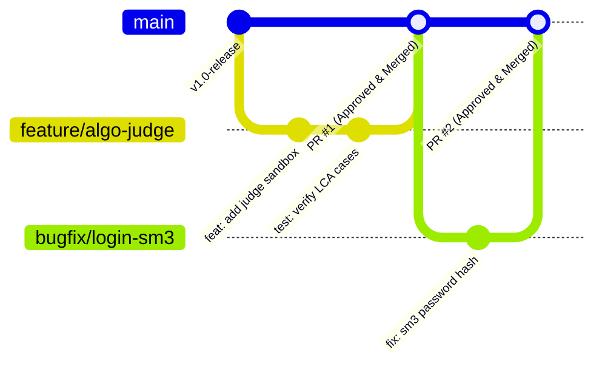

# 图灵 (Tuling) · 高校学科竞赛与算法实训协同平台

> **GitHub 仓库**：[https://github.com/yvemiz/tuling](https://github.com/yvemiz/tuling)  
> **线上演示地址**：[https://goofree.xyz/](https://goofree.xyz/)  
> **使用教程指引**：[全角色综合图文教程](docs/FRONT_WEB_USER_TUTORIAL.md) | [高清印刷版教程 (PDF)](docs/FRONT_WEB_USER_TUTORIAL.pdf) | [👨‍🎓 学生指南](docs/STUDENT_TUTORIAL.md) | [👑 组长指南](docs/LEADER_TUTORIAL.md) | [👨‍🏫 教师指南](docs/TEACHER_TUTORIAL.md)  
> **生产部署指南**：[Docker 容器化部署指南](deploy/README_DEPLOY.md)

本项目基于 **小诺（Snowy 3.0）** 高性能微内核架构二次深度定制开发，打造集 **学科竞赛组队全流程管理**、**算法作业在线评测与智能批改**、**多模态合规研讨论坛** 以及 **AI团队诊断评估模型** 于一体的数字化协作实训门户。

---

## 🌟 核心特性与业务矩阵

### 1. 三元角色权限与工作台体系
平台采用严格的数据权限与视图隔离，支持三种角色即时协同：
* **参赛学生 (STUDENT)**：
  * 竞赛广场探索：关注赛事、单人赛一键直报、组队赛创建项目成为组长或申请入组；
  * 算法实训研习：在线查看算法作业规约，支持 Java / C++ / Python / Go 多语言代码提交；
  * 被催交系统提醒：实时接收老师催交提醒，提交算法后自动消除催交通知；
  * 个人成长档案：查看已获证书、关注动态，以及个人 AI 发展综合诊断报告（雷达图、发展建议、学业预警）。
* **项目组长 (LEADER)**：
  * 团队全权管理：队员审批、移出队员、项目公开/私密隐私设置（私密项目全网隔离不可查）；
  * 招募引才雷达：向对本竞赛感兴趣的学生精准发起入队邀请；发布团队招募令挂牌求贤；
  * 社区民主联审：与教师共同参与社区存疑帖子联审，组长满 2 票赞成即可自动放行。
* **指导教师 (TEACHER)**：
  * 竞赛全周期统筹：发布新竞赛、编辑规程、赛事截止时间自动流转监控；
  * 获奖证书防伪核验：对学生/队伍上传的竞赛获奖证书进行原件认证审核；
  * 算法作业全景督查：发布算法任务，多维批改打分，支持“一键催交全部未交学生”或“单人精准催交”；
  * 社区一票终局决裁：对 AI 拦截或举报内容拥有一票决裁发布或彻底驳回权限，支持置顶热帖；
  * 团队综合评定与放榜：对项目团队综合能力给出教师评分，一键公开发布全校综合排行榜殿堂。

---

### 2. 竞赛广场与全生命周期流转
* **状态智能流转引擎**：
  * 🔥 **报名中 (`ENROLLING` / `SIGNUP`)**：支持单人一键报名或组队模式报名，实时展示报名截止倒计时；
  * 🚀 **比赛中 (`ONGOING`)**：报名截止后自动流转进入作品研发阶段；
  * 📝 **评审中 (`REVIEWING`)**：导师与评审专家入场评阅团队阶段性成果与源码；
  * 🏁 **已结束 (`FINISHED`)**：赛事时间截止后系统自动归档置灰，前后台防呆拦截禁止新报名。
* **复杂拓扑关系闭环**：
  * 项目与竞赛：多对多（一个成熟团队可参加多个关联赛事）；
  * 项目与组长：一对一（严格责任制）；
  * 项目组与组员：多对多（学生可跨组协作，组长亦可在其他项目组担任核心开发成员）。

---

### 3. 算法作业在线评测与教师催交通道
* **算法作业工作流**：
  * 题目规程、时空复杂度指标要求、标准输入输出样例定义；
  * 多语言在线代码编辑器，支持直接编写提交或文件上传；
  * 在线评测执行引擎，自动计算运行结果、打出算法得分并附带性能分析；
* **工业级催交流转机制**：
  * 教师端仪表盘直观展现“已交/未交”学生名单；
  * 支持一键批量催交与单人定向催交；
  * 学生工作台顶部实时醒目红标闪烁“您有待完成算法作业被教师催交”，学生提交作业后系统自动解除催交状态。

---

### 4. 社区研讨论坛与多模态发帖中心
* **独立发帖页面 (`/forum/publish`)**：
  * 💡 **学术探讨与经验交流**：自由研讨、支持富文本、自定义多标签、研究方案文件上传；
  * 💻 **算法题解与源码精析**：多语言切换（Java/C++/Python/Go等）、等宽代码编辑器、时空复杂度量化输入（$O(N)$ / $O(1)$）、样例数据对照；
  * 📢 **组长引才团队招募令**：直通当前负责的参赛项目，设定急缺岗位要求、拟招名额、投入时间与联系方式；
  * 🏆 **赛事历程与通关秘籍**：关联参赛赛事，发布备赛答辩复盘及赛事成果总结附件。
* **独立帖子详情页 (`/forum/detail/:id`)**：
  * 作者身份专属徽章：【指导教师】 / 【项目组长】 / 【参赛学生】；
  * 暗黑高亮代码块：支持一键复制源码、时空复杂度分析面板；
  * 组长招募令直通车：直达对应项目团队主页并快速申请加入；
  * 全功能多级互动：楼中楼评论、回复交流；教师一键置顶与快捷审核。
* **AI 风控 + 教师/组长多级智能联审**：
  * AI 智能语义合规扫描：违规敏感词自动截断驳回，潜在风险自动归入待审专区；
  * 教师一票决裁发布 / 组长表决满 2 票自动解冻通过。

---

### 5. 团队 AI 两维评估模型与全校排行榜
* **AI 团队诊断模型**：
  $$\text{团队综合分} = \text{算法作业完成度}(50\%) + \text{竞赛实战活跃度}(50\%)$$
* **全校天梯榜**：
  * 教师在管理面板进行总评核验，点击“一键公开发布”后全校实时上榜；
  * 首页、排行榜殿堂大屏同步渲染前三甲团队勋章与评分详情。

---

## 🛠️ 技术架构

### 后端技术栈
| 技术组件 | 版本 / 方案 | 描述 |
| :--- | :--- | :--- |
| **基础底座** | Snowy 3.0 微内核插件化架构 | 国产优质模块化开源底座 |
| **运行环境** | Java 17 (JDK 17.0.11) | 现代化 LTS Java 运行时 |
| **核心框架** | Spring Boot 3.5.9 | 微服务与核心 IOC/AOP 基础设施 |
| **持久层** | MyBatis-Plus 3.5.15 | 简化 CRUD、Lambda 类型安全查询与自动分页 |
| **双端安全鉴权** | Sa-Token 1.44.0 | 管理端 (`StpUtil`) 与前台门户端 (`StpClientUtil`) 会话与权限隔离 |
| **工具库** | Hutool 5.8.34 | JSON 序列化、字段扩展与数据流处理 |
| **缓存与数据存储** | Redis 6.0+ / MariaDB 10.4+ / MySQL 8.0+ | 高性能键值缓存与关系型持久化存储 |

### 前端技术栈
| 工程模块 | 核心技术 | 说明 |
| :--- | :--- | :--- |
| **前台协作门户 (`snowy-front-web`)** | Vue 3.5 + Vite 5.4 + Ant Design Vue 4.2 | 响应式门户、玻璃拟态卡片美学、Pinia 状态管理 |
| **管理后台端 (`snowy-admin-web`)** | Vue 3 + Ant Design Vue + Vite | Snowy 3.0 原生运营与系统权限配置后台 |

---

## 📂 项目工程目录概览

```text
st_homework_manage/
├── README.md                           # 本项目全景说明文档
├── .gitignore                          # Git 忽略配置（已过滤大文件与隐私缓存）
├── build-all.bat                       # Windows 一键全栈打包构建脚本
├── st_student_competition_schema.sql   # 业务核心数据库 DDL（含竞赛、算法、项目、社区表）
├── seed_algo.sql                       # 算法任务与测试种子数据
├── deploy/                             # 🐳 Docker 生产化部署工程全集
│   ├── docker-compose.yml              # 全栈 5 个服务的 Docker Compose 编排
│   ├── deploy.sh                       # Linux/宝塔面板一键部署运维脚本
│   ├── README_DEPLOY.md                # 生产环境与宝塔面板保姆级部署指南
│   ├── backend/                        # 后端 Dockerfile
│   ├── admin-web/                      # 管理后台 Nginx 配置与 Dockerfile
│   ├── front-web/                      # 用户门户 Nginx 配置与 Dockerfile
│   └── db/                             # 初始数据库 DDL (init.sql)
├── snowy/                              # 后端微内核及业务插件反应堆
└── snowy-front-web/                    # 前台用户门户前端系统 (Port: 5174)
```

---

## 🐳 生产环境 Docker 容器化一键部署 (支持宝塔面板)

本项目提供开箱即用的工业级 Dockerfile 与 `docker-compose.yml` 编排方案，已适配各大云服务器与宝塔面板环境：

1. **构建生产部署物**：
   在 Windows 本地直接双击运行根目录的 `build-all.bat`，即可自动完成前后端编译并归集到 `deploy` 目录。
2. **服务器一键拉起**：
   将 `deploy` 目录上传至服务器（如 `/www/wwwroot/st_homework_manage`），执行：
   ```bash
   chmod +x deploy.sh
   ./deploy.sh up
   ```
3. **网络与安全隔离**：
   - 用户端门户：`http://<YOUR_SERVER_IP>:8080`
   - 管理端后台：`http://<YOUR_SERVER_IP>:8081`
   - 后端 API、Redis、MySQL 全链路在 Docker 专有内网闭环，**无需对外暴露 82 端口，极大提升服务器防护安全性**。
   - 更多详情请参阅专有部署文档：`deploy/README_DEPLOY.md`。

---

## 🚀 本地开发环境快速启动指南

### 1. 环境准备
* **JDK**：OpenJDK 17 或 Oracle JDK 17+
* **Node.js**：v18.0.0+（推荐 Node.js v20+）
* **数据库**：MariaDB 10.4+ 或 MySQL 8.0+
* **缓存**：Redis 6.0+
* **构建工具**：Apache Maven 3.8+

### 2. 数据库与缓存初始化
1. 启动本地 MariaDB/MySQL 服务（端口 `3306`）及 Redis 服务（端口 `6379`）；
2. 创建主数据库（字符集为 `utf8mb4`）：
   ```sql
   CREATE DATABASE st_homework_manage DEFAULT CHARACTER SET utf8mb4 COLLATE utf8mb4_general_ci;
   ```
3. 导入基础底座与业务结构（可直接导入纯净版 `deploy/db/init.sql`，或依次执行底座与业务 SQL）；
4. 确认 `snowy/snowy-web-app/src/main/resources/application.properties` 中的数据库配置无误。

### 3. 启动服务
* **后端服务**：在 `snowy` 目录下执行 `mvn clean package -DskipTests`，然后运行 `snowy-web-app`。端口：`http://localhost:82`（Knife4j 文档：`http://localhost:82/doc.html`）。
* **前台门户**：在 `snowy-front-web` 目录下执行 `npm install` 并 `npm run dev`。访问：`http://localhost:5174`。
* **管理后台**：在 `snowy/snowy-admin-web` 目录下执行 `npm install` 并 `npm run dev -- --port 81`。访问：`http://localhost:81`。

---

## 🔑 系统账号与角色使用说明

1. **超级管理员 (后台系统)**：
   - 登录地址：`http://localhost:81`（生产环境为 `8081`）
   - 默认账号：`superAdmin`
   - 默认密码：`123456`（首次部署上线后请立即在个人中心修改初始密码）
   - 职责：维护组织机构、字典、系统配置、批量导入全校学生学籍档案（学号白名单）、在【用户管理】中为老师分配 `TEACHER` 角色与工号。

2. **指导教师 (TEACHER)**：
   - **后台统一分发制**：前台不支持自主注册。由管理员在后台【用户管理】统一录入教师工号并分配初始密码，教师直接登录使用。

3. **参赛学生 (STUDENT) 与项目组长 (LEADER)**：
   - **学籍白名单预录入机制**：学生**无法随意虚假注册**，且**无系统默认初始密码**！
   - **自主设密激活**：管理员预先在后台批量导入学生学籍档案（学号、姓名、学院班级）。学生首次访问前台门户 `http://localhost:5174`（生产环境为 `https://goofree.xyz/`），进入【学生注册激活】标签页，输入**真实学号**并**自行设置登录密码**。系统自动匹配后台学籍名册完成激活建档并自动登录；若学号不在导入名单中则无法注册。激活后永久使用该自设密码登录。
   - **组长身份动态晋升**：组长本质是认证学生，经学号激活登录后，在平台创建任意竞赛项目组，系统即刻动态晋升其为【👑 团队组长】，解锁全套指挥空间。

4. **前台前端全角色图文使用教程与实操手册**：
   - 包含全角色综合教程、三大角色专属实操分册以及高清界面截图，详见：
     - 📖 **[全角色综合图文教程 (docs/FRONT_WEB_USER_TUTORIAL.md)](docs/FRONT_WEB_USER_TUTORIAL.md)**
     - 📄 **[高清印刷版使用教程 (docs/FRONT_WEB_USER_TUTORIAL.pdf)](docs/FRONT_WEB_USER_TUTORIAL.pdf)**
     - 👨‍🎓 **[《参赛学生实操全指南》(docs/STUDENT_TUTORIAL.md)](docs/STUDENT_TUTORIAL.md)**
     - 👑 **[《项目组长团队治理与指挥全指南》(docs/LEADER_TUTORIAL.md)](docs/LEADER_TUTORIAL.md)**
     - 👨‍🏫 **[《指导教师教学督导与评审全指南》(docs/TEACHER_TUTORIAL.md)](docs/TEACHER_TUTORIAL.md)**

---

## 🤝 团队协作与代码提交规范 (Git Flow & Collaboration)

为了保障主干代码的生产稳定性与多人协作的高效有序，本项目严格执行 **“主分支保护 + 特性分支开发 + PR代码审查 (Code Review)”** 工作流。所有成员均可拉取和提交代码，但**严禁直接 Push 到 `main` 分支**。



### 1. 分支管理策略 (Branching Strategy)
- 🔒 **`main`（受保护主分支）**：
  - 生产就绪代码基线，**设置强保护规则**；
  - 只有项目负责人（Owner / Admin）在完成代码审查与本地验证后方可执行合并；
  - 禁止任何人执行 `git push origin main` 或 `--force` 强推。
- 🌿 **`feature/<功能名>`（特性开发分支）**：
  - 用于开发新功能或模块（如 `feature/ranking-radar`、`feature/teacher-cert`）；
  - 从最新的 `main` 切出，开发测试完毕后向 `main` 提交 Pull Request。
- 🐞 **`bugfix/<问题名>` 或 `hotfix/<紧急修复>`（缺陷修复分支）**：
  - 用于修复发现的缺陷或漏洞（如 `bugfix/login-sm3-check`）；
  - 从 `main` 切出，验证通过后向 `main` 发起 Pull Request。

---

### 2. 团队成员开发全流程实操指南 (Member Workflow)

所有开发人员在日常开发中请严格遵循以下六步法则：

#### 第一步：同步主干最新代码
在开始任何开发前，先保证本地 `main` 分支为最新：
```bash
git checkout main
git pull origin main
```

#### 第二步：创建属于自己的特性分支
切出独立的业务分支，禁止直接在 `main` 分支上写代码：
```bash
# 格式：feature/功能简写 或 bugfix/问题简写
git checkout -b feature/your-feature-name
```

#### 第三步：本地编码与构建验证
编写代码，并务必在本地确认编译通过、无语法报错与敏感泄密：
```bash
# 后端编译验证
mvn clean compile -DskipTests
# 前端构建验证
npm run build
```

#### 第四步：提交代码（遵循 Conventional Commits 规范）
```bash
git add .
git commit -m "feat(portal): 增加算法评测运行时间统计展示"
```

#### 第五步：推送到远程自己的分支
```bash
# 将代码推送到远程的 feature 分支（而不是 main 分支！）
git push -u origin feature/your-feature-name
```

#### 第六步：在 GitHub 发起 Pull Request (PR)
1. 访问仓库 [https://github.com/yvemiz/tuling](https://github.com/yvemiz/tuling)；
2. 页面会弹出提示 **`Compare & pull request`**，点击进入；
3. Base 分支选择 **`main`**，Compare 分支选择您刚刚推送的 **`feature/your-feature-name`**；
4. 填写本次修改的简述、自测通过情况及影响范围，点击 **`Create pull request`**；
5. 通知项目负责人（审查人）进行审查。

---

### 3. 项目负责人（审查人）代码审查与合并指南 (Review & Merge Workflow)

作为项目负责人，当收到成员提交的 PR 后，按以下步骤审查并合并：

#### 方式一：本地审查验证（推荐，最稳妥）
切到成员的分支，在本地运行确认无误后再合并回主分支：
```bash
# 1. 抓取远端所有分支
git fetch origin

# 2. 切换到成员的 feature 分支
git checkout feature/your-feature-name
git pull origin feature/your-feature-name

# 3. 在本地运行项目，检查代码质量、是否包含敏感配置、业务逻辑是否正确
# 确认一切符合规范后，切回 main 分支进行合并：
git checkout main
git pull origin main
git merge --no-ff feature/your-feature-name

# 4. 推送到远端 main（只有负责人具备 main 推送/合并权限）
git push origin main

# 5. （可选）删除已完成使命的 feature 分支
git branch -d feature/your-feature-name
git push origin --delete feature/your-feature-name
```

#### 方式二：GitHub 网页端一键审查与合并
1. 进入 GitHub 仓库的 **Pull requests** 标签页，点击待审查的 PR；
2. 点击 **`Files changed`** 查看代码具体改动（Diff）；
3. 确认逻辑无误、构建无冲突后，点击 **`Merge pull request`** ➔ **`Confirm merge`**；
4. 合并完成后，点击 **`Delete branch`** 自动清理远端废弃分支。

---

### 4. Git Commit 提交信息规范 (Conventional Commits)

提交信息采用结构化规范：`<type>(<scope>): <subject>`，常用类型定义如下：

| 标识 (Type) | 语义说明 | 示例 |
| :--- | :--- | :--- |
| `feat` | 新增功能 (Feature) | `feat(oj): 增加代码提交沙箱判题结果展示` |
| `fix` | 修复缺陷 (Bug Fix) | `fix(auth): 解决前台用户SM3密码哈希比对失败问题` |
| `docs` | 文档变更 (Documentation) | `docs(readme): 补充团队协作规范与贡献流程` |
| `style` | 样式与格式变动（不影响代码逻辑） | `style(front-web): 优化天梯榜单移动端对齐样式` |
| `refactor` | 代码重构（既不修复 bug 也不增加新功能） | `refactor(portal): 提取角色权限感知通用服务工具类` |
| `perf` | 性能提升 (Performance) | `perf(ranking): 引入 Redis 缓存天梯排行榜综合得分` |
| `test` | 增加或修改测试用例 | `test(algorithm): 补充二叉树LCA边界判题测试集` |
| `chore` | 构建流程、依赖或辅助配置调整 | `chore(docker): 调整后端容器内存上限配置` |

---

### 5. 提交安全红线与自查清单 (Security Checklist)
- ❌ **严禁硬编码隐私信息**：包括服务器真实公网 IP、生产数据库密码、私有 AccessKey/Secret 等；
- ❌ **严禁提交大文件与二进制包**：切勿将 `deploy.zip`、`*.jar`、本地 `node_modules` 强行提交进仓库；
- ✅ **确保通过编译**：提交前必须在本地成功执行 `mvn compile` 或 `npm run build`，不得提交无法编译的半成品代码；
- ✅ **保持原子性**：一个分支只解决一个明确的功能或缺陷，避免超大 PR 难以审查。

---

## 🛡️ 安全合规与开源说明
1. **多端令牌隔离**：管理后台采用 `satoken` 独立 Header，前台门户采用 `token` 客户端独立 Header，杜绝越权；
2. **AI 内容风控**：所有论坛发帖均经由智能语义规则扫描，违规即时拦截，存疑帖流转至联审机制；
3. **隐私脱敏保证**：开源版本已过滤大文件与私有运行时缓存，生产部署支持内网闭环通信。
