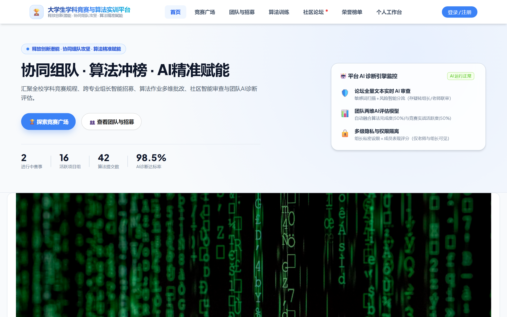
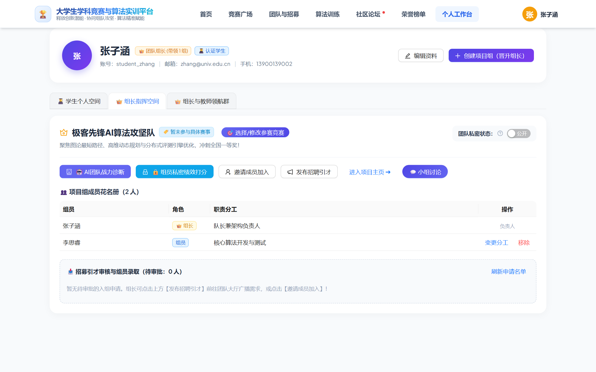
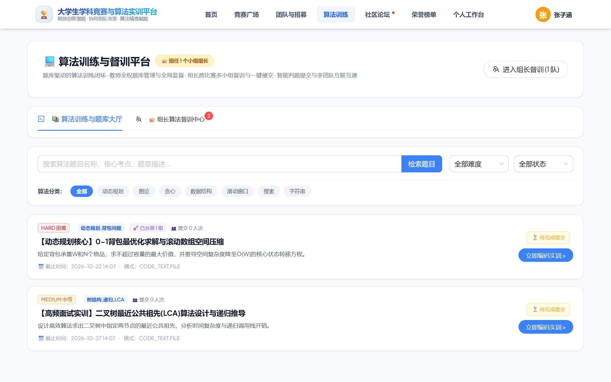
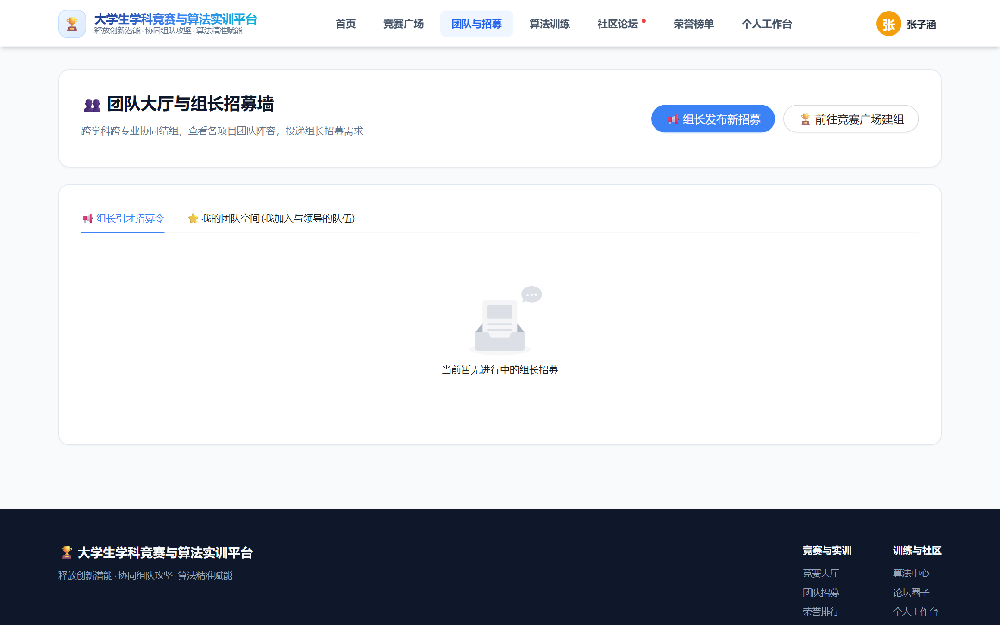
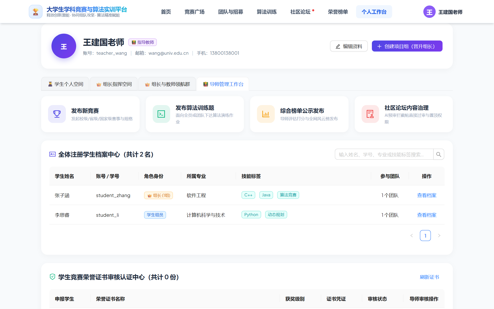
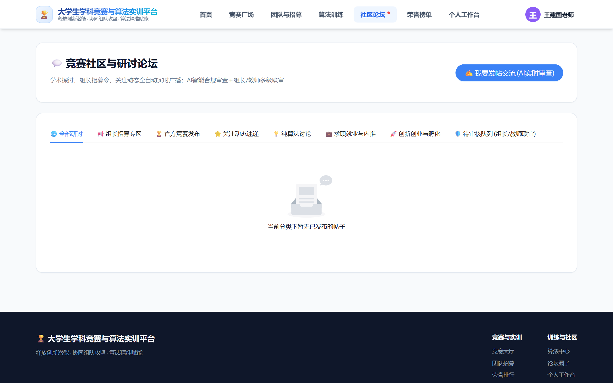
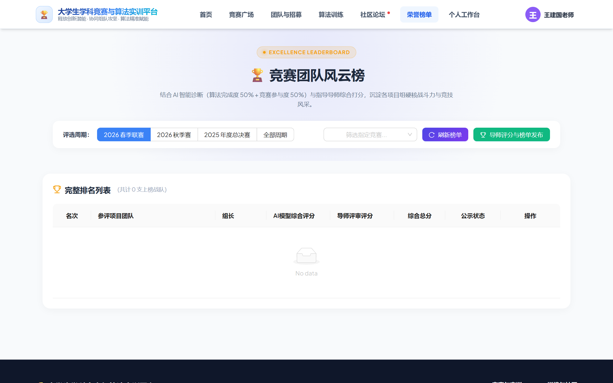

# 高校学科竞赛与作业管理系统 · 前台前端使用教程（教师 / 学生 / 组长）

> **系统名称**：高校学科竞赛与智能作业管理系统（前台门户 `snowy-front-web`）  
> **服务访问地址**：`https://goofree.xyz/`（线上官方访问地址） / `http://localhost:5174`（本地开发调试）  
> **设计定位**：为高校师生提供集竞赛组织、团队招募、算法作业在线评测、荣誉天梯、学术研讨与AI成长画像于一体的现代化交互门户。  
> **专属角色分册直达**：  
> - 👨‍🎓 **[《参赛学生实操全指南》](STUDENT_TUTORIAL.md)**（认证注册、算法实训OJ、做题消催、晋级确认、能力雷达与防伪证书）  
> - 👑 **[《项目组长团队治理与指挥全指南》](LEADER_TUTORIAL.md)**（建队晋升、私密备赛开关、赛事绑定、引才审核、AI战力诊断、私密绩效打分、师生领航大群）  
> - 👨‍🏫 **[《指导教师教学督导与评审全指南》](TEACHER_TUTORIAL.md)**（竞赛规格发布、算法作业命题、综合风云榜评审公示、学生档案中心、证书线上认证、领航群指导）  

---

## 快速导航与账号准入机制

系统内置了严格的学籍准入模型与角色自适应感知引擎：

| 角色类型 | 账号获取与激活方式 | 核心职责与空间权限 | 专属指南分册 |
| :--- | :--- | :--- | :--- |
| **指导教师（TEACHER）** | **管理员后台统一分发**：前台不支持自主注册，由教务管理员在管理后台统一创建工号并下发初始密码。 | 激活【👨‍🏫 导师管理工作台】：发布竞赛、发布算法题、综合榜单评审公示、全体学生档案管理、学生证书在线认证审核、领航大群督导、论坛置顶决裁 | [教师使用指南](TEACHER_TUTORIAL.md) |
| **项目组长（LEADER）** | **学生建队动态晋升**：学生使用真实学号激活后，在平台创建 1 支及以上团队即自动晋升队长。 | 激活【👑 组长指挥空间】：创建团队、私密开关、赛事绑定、成员招募审批与移除、分工指派、AI团队战力诊断、组员私密绩效打分、算法一键催交、领航群协同 | [组长使用指南](LEADER_TUTORIAL.md) |
| **参赛学生（STUDENT）** | **学号白名单预录入 + 自设密码激活**：**无系统默认初始密码**！必须输入管理员预导入的真实学号，由学生自行设定登录密码完成激活。 | 默认【👨‍🎓 学生个人空间】：竞赛组队申请、待办任务中心、赛事晋级一键升级、算法实训在线OJ、做题消除催交通知、小组实时讨论群、AI五维能力雷达、防伪证书 | [学生使用指南](STUDENT_TUTORIAL.md) |

---

## 零、前台门户全景与首页概览

系统首页采用赛博科技与高校学术相结合的现代极简风格，集成全校竞赛大数据指标、最新赛事滚屏、顶尖攻坚团队招募墙及学术天梯雷达。

### 首页核心版块介绍：
1. **顶部导航栏**：
   - **首页（Home）**：聚合态势大屏与通知枢纽；
   - **学科竞赛（Competitions）**：国赛、省赛、校赛聚合大厅与在线申报；
   - **算法题库（Algorithms）**：涵盖动态规划、树论、图论的在线实训靶场；
   - **团队招募（Projects）**：全校跨学院、跨专业项目组招募广场；
   - **学术论坛（Forum）**：技术答疑、经验分享与官方置顶通知；
   - **天梯排行榜（Rankings）**：学院及个人算法与竞赛综合战力榜；
   - **个人工作台 / 登录注册入口**：根据当前登录角色自动激活对应控制台。
2. **综合数据看板**：
   - 实时统计全校**已立项队伍**、**上线算法挑战题**、**活跃参赛师生**与**累计获奖荣誉**。
3. **顶尖竞赛与精英团队直通车**：
   - 快速浏览进行中的国家级/省级竞赛日程，支持卡片一键直达详情与申报。

---

## 第一章 学生角色（STUDENT）使用指南

学生是平台的核心受众，涵盖“学号激活”、“竞赛申报”、“算法实训”、“团队协作”与“荣誉沉淀”完整闭环。详细实操可参阅 **[《参赛学生实操全指南》](STUDENT_TUTORIAL.md)**。

### 1.1 学号匹配与自主设密激活（核心准入机制）
> [!IMPORTANT]
> **学号预导入与白名单准入机制**  
> 1. **严禁随意虚假注册**：本系统严密对接学校教务学籍体系，学生**无法随意填写姓名班级注册**。全校学籍档案（学号、姓名、学院班级）由学校管理员在管理后台提前批量导入。  
> 2. **无统一初始密码**：系统**未给学生设置任何默认初始密码**。未激活的学生初次登录系统时，必须通过“验证学号并自主设置密码”完成激活。

#### 首次激活操作步骤：
1. 点击右上角【登录 / 注册】按钮，切换至 **【学生注册激活】** 标签页；
2. 输入您的 **【学生学号】**（如 `202308001` 或 `ST20261001`）；
3. **自主设置登录密码**：输入“设置登录密码”及“确认登录密码”（不少于 6 位）；
4. 点击 **【🚀 验证学号并激活账号】**：
   - **白名单匹配成功**：系统后台秒级匹配预导入学籍库，自动绑定真实姓名与班级，加密存储您自设的密码，并**全自动为您登录系统**；
   - **未匹配拦截**：若管理员尚未录入您的学号，系统报错拦截：*“未在预导入学籍档案库中匹配到学号【XXX】，请核对学号或联系管理员导入！”*
5. **后续登录**：激活后直接在【账号密码登录】使用 `学号 + 自设密码` 登录。遗忘密码可联系管理员后台重置。

### 1.2 待办任务中心与赛事晋级流转（核心特色）
工作台集成了结构化的【待办任务与通知中心】：
1. **多维分类筛选**：支持快速切换【全部】、【晋级确认】、【竞赛题/算法】、【荣誉上传】、【审批与绑定】；
2. **🎉 赛事晋级确认**：当团队通过初赛选拔后，待办中心出现通知卡片，学生点击 **【🎉 确认升级至复赛/决赛】**，赛程状态自动流转并更新天梯排位分；
3. **🎯 团队赛事绑定**：若所在团队未确定赛事，学生可在此协同组长快速选报。

### 1.3 团队协作与小组内部加密讨论
1. **处理入队邀请**：若组长主动发起邀请，工作台弹出高亮横幅，支持一键【接受加入】或【婉拒】；
2. **💬 小组实时讨论群**：
   - 在【我参与的项目团队】卡片中点击【💬 小组讨论】；
   - 按钮自带实时**未读消息红点徽标**，点击进入专属加密聊天室与队友研讨。

### 1.4 算法作业在线实训与评测（Online Judge）

1. 点击顶部导航栏【算法题库】，进入题库大厅；
2. **多维筛选**：支持按算法分类（`动态规划`、`二叉树与图论`、`贪心与搜索`、`数学与字符串`）和难度级别（`入门`、`简单`、`中等`、`困难`）进行检索；
3. **在线实训与代码提交**：
   - 点击题目卡片（如“最长公共子序列 LCS”），进入沉浸式答题界面；
   - 查阅题目背景、输入输出格式约束、时间/空间复杂度限制与标准样例；
   - 选择编程语言（`Java` / `Python` / `C++` / `Go`），在代码编辑器中编写算法逻辑；
   - 点击【提交评测】，后台沙箱自动执行全套隐藏测试用例；
   - 判题即刻反馈：Accepted (AC)、Wrong Answer (WA)、Time Limit Exceeded (TLE) 或 Runtime Error (RE)。

### 1.5 催交通知接收与“做题消催”机制
> [!IMPORTANT]
> **算法催交智能闭环机制**  
> 当团队组长针对某项算法作业发起催交时，未完成队员的【个人工作台】顶部会浮动高亮闪烁的**催交通知横幅**（如“动态规划专项作业催交”）。  
> **消除催交的唯一途径**：点击通知直达对应题目完成代码提交并通过评测（AC），系统将自动核销该催交通知并同步更新组长面板。

### 1.6 AI 算法能力成长画像与防伪荣誉证书
1. **五维能力雷达图**：
   - 工作台集成 AI 综合评估引擎，根据学生的做题正确率、算法标签分布、竞赛参与度与代码执行效率，生成专属的**动态规划、数据结构、数学几何、图论搜索、工程设计**五维战力雷达。
2. **防伪电子证书**：
   - 获奖学生可在工作台查看或下载由系统颁发的**区块链级防伪唯一核验码证书**。
   - 证书自带全校统一生成的防伪编码，任何单位或导师均可通过前台/后台直接核验真伪。

---

## 第二章 组长角色（LEADER）使用指南

组长是学生群体中的骨干领袖，承担着“团队创立”、“队员招募”、“分工管控”、“战力诊断”与“算法督促”的管理职责。详细实操可参阅 **[《项目组长团队治理与指挥全指南》](LEADER_TUTORIAL.md)**。

### 2.1 创建团队与晋升组长
1. 点击顶部导航栏【团队招募】或直接在【个人工作台】点击右上角 **【创建项目组（晋升组长）】**；
2. 填写团队名称、所属竞赛、团队简介与主攻技术方向；
3. 提交后，创建者自动晋升为该团队的**队长（LEADER）**，工作台专属解锁【👑 组长指挥空间】。

### 2.2 团队私密状态开关（备赛防窥保护）
每支团队卡片右上角均配备专属的 **【团队私密状态切换开关】**：
- **🌐 公开模式**：全校师生可在团队大厅浏览该队伍；
- **🔒 私密模式**：全校搜索与大厅隐匿该团队，仅正式组员与导师可见，杜绝核心算法方案外泄。

### 2.3 赛事绑定与自由调整
若团队初始未关联赛事（标示为 `🏷️ 暂未参与具体赛事`），组长点击 **【🎯 选择/修改参赛竞赛】** 即可一键绑定目标赛事，纳入官方赛程申报流水线。

### 2.4 招募引才、定向邀请与组员录取决裁
1. **发布招募引才**：在卡片工具箱点击【发布招聘引才】，定义所需岗位（如“前端工程师 1名”）广播至团队大厅；
2. **审核录用组员**：在【招募引才审核与组员录取】面板查阅申请者履历，一键点击 **【✅ 接受组员】** 或 **【婉拒】**；
3. **主动定向邀请**：点击【邀请成员加入】直接输入目标学生姓名或学号发起定点邀请。

### 2.5 成员分工变更、组员移出与私密绩效打分
1. **成员花名册治理**：组长可为组员灵活配置分工职责（如“核心算法 / 动态规划主攻”）；对离队组员执行【移除成员】；
2. **🔒 组员私密绩效打分**：组长可针对各组员的阶段性代码贡献与协作态度进行私密打分与评价，受系统加密保护，供指导导师评审考量。

### 2.6 智能化战力诊断与算法作业催交
1. **🤖 AI团队战力诊断**：一键调用系统 AI 引擎，拉取全队能力模型，输出技术栈互补度、短板警示与赛事胜率预测；
2. **算法作业一键催交**：直观监控全员算法作业完成率，针对逾期组员一键派发红色催交通知，跟踪消除进度。

### 2.7 👑 组长与教师领航群跨级交流
> [!IMPORTANT]
> **自动进退领航群机制**  
> 只要名下拥有 1 支及以上项目组，系统**全自动激活【👑 组长与教师领航群】特权**；名下无项目组时自动回收。  
> 导师在群内发布重要指导时，组长工作台常驻浮动高亮横幅提示，确保关键指令零延时传达。

---

## 第三章 指导教师（TEACHER）使用指南

指导教师账号拥有前台高级学术与教学督导特权。教师登录后，工作台将无缝接入【👨‍🏫 导师管理工作台】。详细实操可参阅 **[《指导教师教学督导与评审全指南》](TEACHER_TUTORIAL.md)**。

### 3.1 学科竞赛规格发布与赛程管理
1. 在导师工作台点击 **【发布新竞赛】** 快捷入口；
2. 完整录入赛事规格：
   - **赛事名称**（如“2026第十四届全国大学生计算机系统与算法挑战赛”）；
   - **赛事级别**（国家级 / 省部级 / 校级重点）；
   - **报名与答辩起止周期**；
   - **组队限制**（如每队 1-5 人）；
   - **赛题指导指南与附件材料**；
3. 保存发布后，竞赛全网推送到前台首页【学科竞赛】大厅。

### 3.2 算法题库扩展与沙箱测试用例录入
1. 点击导师工作台的 **【发布算法训练题】** 功能；
2. 录入题干 Markdown 描述、知识点分类标签、时间与内存上限；
3. 配置**公开自测样例**与**隐藏沙箱判题集**（多组输入、期望输出），保存后即刻生效至全校算法 OJ 系统。

### 3.3 竞赛成果评审与综合榜单公示发布
1. 竞赛结项阶段，进入 **【综合榜单公示发布】** 中心；
2. 对申报团队的项目报告、代码提交质量与算法成绩进行多维打分；
3. 评定【特等奖】、【一等奖】、【二等奖】等奖项，一键点击 **【全网公示发布】**；
4. 榜单全网公示后，系统底层全自动为获奖者下发内嵌**防伪唯一核验溯源码**的电子证书。

### 3.4 全体注册学生档案中心管理（核心亮点）
教师工作台独家内置【全体注册学生档案中心】：
1. **多维模糊检索**：输入姓名、学号、专业或技能标签（如 `Java, Vue3`）即时定位学生；
2. **学生多维透视花名册**：穿透查看学生角色身份（组员/带领 N 组的组长）、技能标签云与参与团队总数；
3. **查阅学生档案**：深入调阅学生算法能力雷达与参赛履历。

### 3.5 学生竞赛荣誉证书审核认证中心
针对学生个人校外竞赛历史荣誉申报：
1. 在工作台【学生竞赛荣誉证书审核认证中心】查阅待审记录；
2. 点击 **【查看原件 ↗】** 在线开窗核验学生上传的荣誉证明附件；
3. 点击 **【审核认证】** 执行 **【✅ 官方认证】** 或 **【❌ 驳回】**，并填写审核评语，认证后直接换算学分与天梯榜积分。

### 3.6 师生领航群在线督导与社区论坛治理
1. **👑 组长与教师领航群**：导师可直接在群内向全校项目组长发布技术方向指引、答辩规范与赛程广播；
2. **学术研讨论坛内容治理**：
   - 针对 AI 风控系统误判拦截的代码研讨贴，导师具备人工复核终审赦免特权；
   - 对全站顶级算法题解一键设置【加精】与【全站置顶】。

---

## 第四章 校园公共学术与荣誉空间

除了个人工作台外，系统还提供两大全校性协同枢纽：

### 4.1 社区研讨论坛（Forum Center）

- **学生与组长**：自由发布算法题解（如“二叉树 LCA 递归解法踩坑录”）、项目招募贴或技术提问，支持 Markdown 语法与代码高亮；
- **教师导师特权**：导师具有社区版主管理特权，可针对优质教学贴进行【加精】或【全站置顶】推荐，并对不当言论执行治理。

### 4.2 全校荣誉天梯排行榜（Ranking Hall）

- **综合排位榜**：采用多维度赋权积分算法（`算法刷题得分 × 权重 + 竞赛获奖等级 × 权重 + 社区贡献`）；
- **学院与个人风云榜**：实时激励学生精进算法、踊跃参赛，形成高校“以赛促学、以题强技”的优良学术风气。

---

## 第五章 常见问题与操作技巧（FAQ）

> [!TIP]
> **Q1：为什么我登录学生账号后，工作台没有“组长指挥空间”？**  
> **A**：组长身份是依据队伍创建归属动态识别的。学生只需在【团队招募】或工作台点击【创建项目组（晋升组长）】成功创建一支队伍，系统将立即自动为您激活组长指挥空间。

> [!TIP]
> **Q2：教师账号可以在前台自己注册吗？**  
> **A**：根据学校安全规范，前台注册入口**仅对学生开放**。教师账号由系统管理员在后台管理系统统一录入，或由管理员在后台分配教师角色标签，以确保导师身份权威合规。

> [!TIP]
> **Q3：在算法在线评测时出现“运行超时（TLE）”怎么办？**  
> **A**：请检查您的代码时间复杂度。例如二叉树 LCA 题目，如果使用暴力遍历可能耗时超出上限，建议改用后序遍历或倍增法优化。

> [!TIP]
> **Q4：怎么查验一份防伪电子证书的真伪？**  
> **A**：在前台任意页面点击【证书核验】功能，输入证书上的防伪编码（如 `CERT-2026-XN-88391`），即可实时调取官方数据库校验获奖学生、赛事与奖项真伪。

---
*本文档由高校学科竞赛与作业管理系统教学指导委员会编制，版权所有。*
